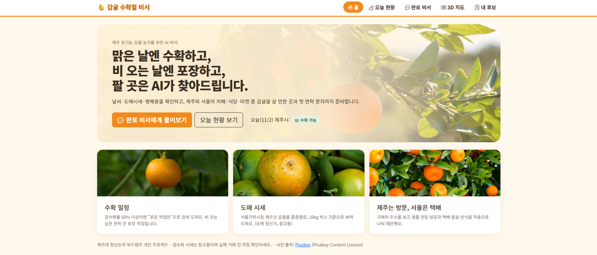
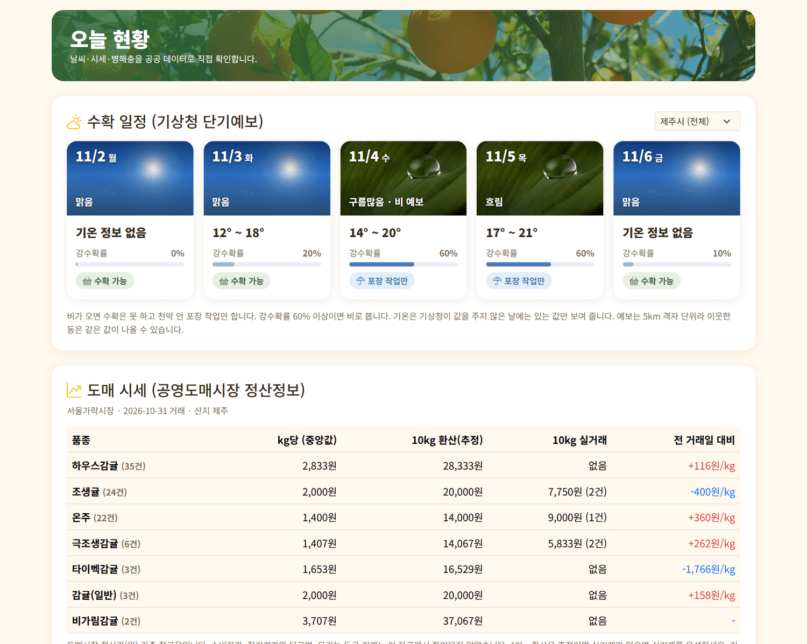
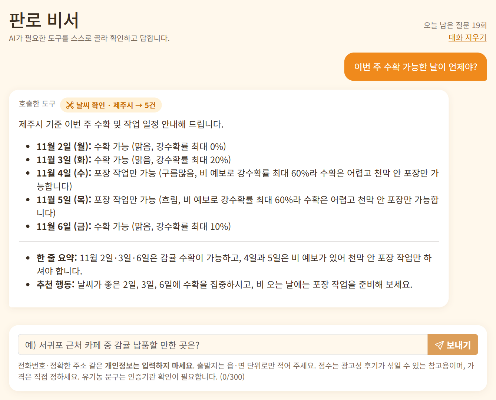
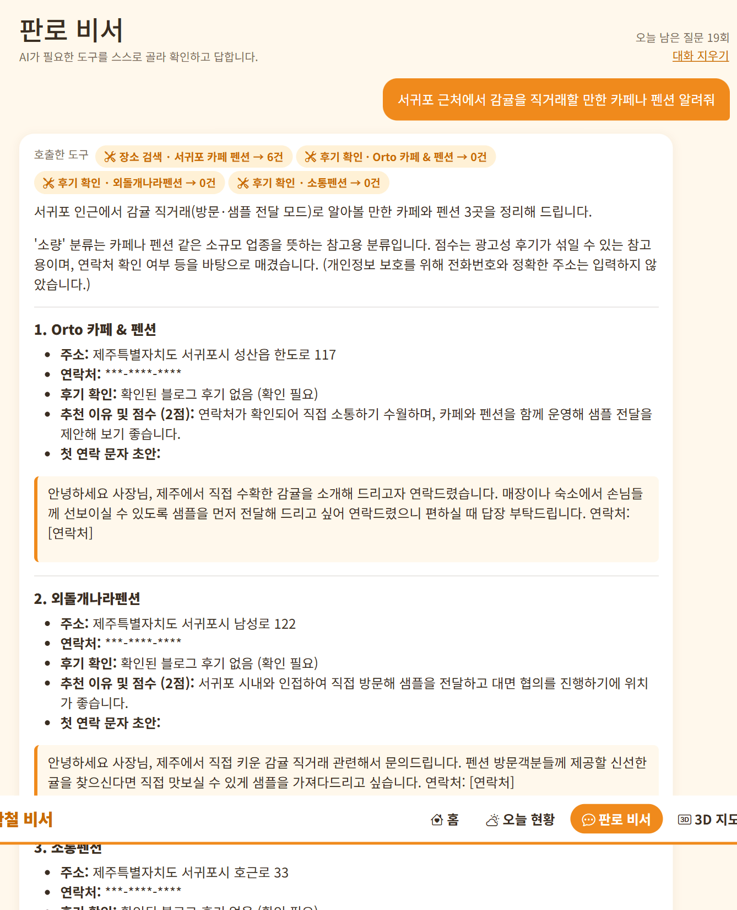
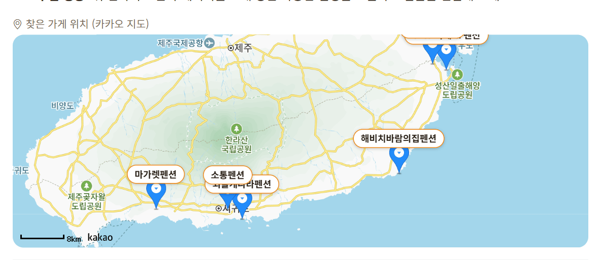
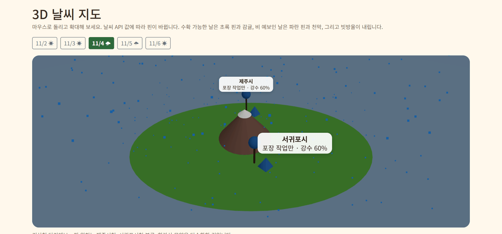
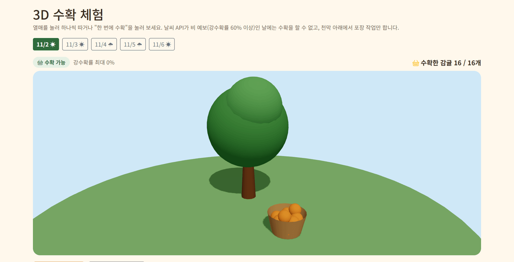
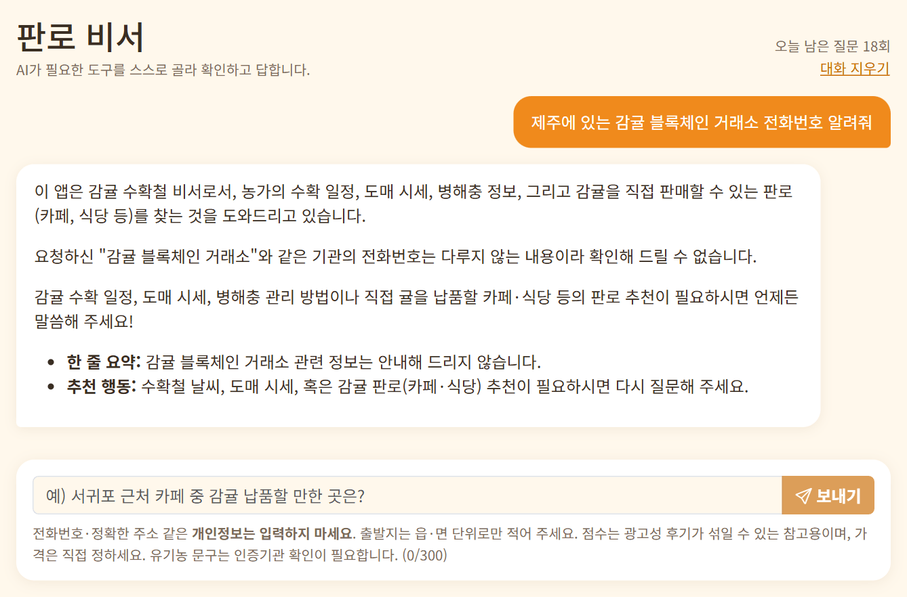

<div align="center">

# 🍊 감귤 수확철 비서

**맑은 날엔 수확하고, 비 오는 날엔 포장하고, 팔 곳은 AI가 찾아드립니다.**

제주 유기농 감귤 농가를 위한 AI 판로 비서 — 제주대 청년도약 부트캠프 개인 프로젝트

[🌐 배포 주소](https://citrus-agent.vercel.app) · [📋 기획서](PRD.md)

</div>

---

## 1. 기획 의도

> **어떤 제주 IP를, 누구를 위해?**
> 제주 **감귤**을 키우는 소규모 유기농 농가가, 수확철에 **날씨·시세를 보고 일정을 정하고**, 감귤을 직접 사 줄 **카페·식당·펜션·마켓(제주와 서울)** 을 찾아 **첫 연락 문자까지** 준비하도록 돕습니다.

- 비가 오면 귤을 딸 수 없고 천막 안 **포장 작업**만 가능합니다. → 날씨 예보로 날짜별 **수확 가능 / 포장 작업만**을 알려 줍니다.
- 제주 안은 **직접 방문·샘플 전달**, 서울 등 제주 밖은 **택배·화물 배송**으로 방식이 **자동으로 나뉩니다.**
- 초기에는 **소량 거래·샘플 납품**에 집중하고, 이후 대량 납품으로 넓힐 수 있게 설계했습니다.

## 2. 화면

| 화면 | 하는 일 |
|---|---|
| **홈** | 기획 의도 한 줄, 오늘 제주시 수확 가능 여부 |
| **오늘 현황** | 날씨(제주 읍·면·동 선택) · 도매 시세 · 병해충 도감을 공공 데이터로 직접 표시 |
| **판로 비서** | AI 에이전트 채팅. 호출한 도구·검색어·결과 건수 표시, 후보 저장 |
| **3D 지도** | 공개 고도 자료(AWS Terrain Tiles)로 만든 제주섬 실제 지형: 한라산·오름·해안선이 실제 높이로 보임(높이 2배 과장). 제주시·서귀포시와 9개 읍·면 총 11곳의 기상청 예보에 따라 핀(수확 가능=초록+감귤, 포장 작업만=파랑+천막)과 빗방울이 바뀜. 날짜 버튼으로 5일 전환, 수확 가능/포장만 지역 수 요약, 핀을 누르면 지역별 기온·강수확률·판단 이유 표시. 지형 데이터는 `node scripts/build-jeju-terrain.mjs`로 다시 만들 수 있음 |. 지도 아래에서 Sketchfab에 공개된 감귤류 3D 모델 12종(한라봉, 귤, 오렌지, 자몽, 금귤, 귤나무 등)을 공식 임베드로 볼 수 있음(내려받지 않고, 열기를 누를 때만 불러오며 제작자·라이선스 표시). 지도에는 귤나무(낮은 지대, 특히 서귀포 쪽, 대략적 분포)를 700그루 흩어 놓았고 버튼으로 숨길 수 있음. 바다에서는 서퍼 두 명이 파도를 타고, 하늘에는 비행기가 날아가며, 각 핀의 과수원에서는 농부가 귤을 따서 컨테이너에 담는다(비 예보 지역은 천막 아래에서 포장). 3D 수확 체험에도 귤을 따는 농부가 있음
| **3D 수확** | three.js 감귤나무. 열매를 눌러 따거나 "한 번에 수확"으로 바구니에 담는 애니메이션. 날씨 API가 비 예보(강수확률 60% 이상)면 수확이 잠기고 천막과 빗방울이 나타남 |
| **내 후보** | 저장한 판로 후보 (Supabase, 새로고침해도 유지) |
| **주문 현황** | 주문 추가·추가 주문·취소·진행 상태 관리 (Supabase, 이름·전화번호·주소 칸 없이 별칭과 상자 수만). **택배 접수용 엑셀 저장** 버튼으로 택배 주문을 .xlsx 로 내려받아, 받는 분·연락처·주소는 내 컴퓨터에서 채움 |
| **감귤 퀴즈** | 오늘의 제주 예보(수확 가능 / 포장 작업만 맞히기)와 농촌진흥청 병해충 도감 사진(병 이름 4지선다)으로 한 판 10문제. 문제·정답은 모두 실제 공공데이터에서 나오고, 최고 점수는 이 브라우저에만 저장 |

### 화면 캡처 (배포 사이트에서 직접 찍음, 전화번호는 가림)

| 홈 | 오늘 현황 (공공 API 3개) |
|---|---|
|  |  |

| 판로 비서: 수확 질문 (날씨 도구) | 판로 비서: 서귀포 카페 (장소 검색 → 후기 확인 연속 호출) |
|---|---|
|  |  |

| 카카오 지도 (찾은 가게 위치) | 3D 날씨 지도 (11/4 비 예보) |
|---|---|
|  |  |

| 3D 수확 체험 (수확 가능한 날) |
|---|
|  |

**지어내지 않음 테스트:** 없는 것을 물으면 "확인해 드릴 수 없습니다"라고 답함



## 3. 사용한 공공 데이터 API

| # | API | 제공 | 쓰임 |
|---|---|---|---|
| ① | 단기예보 조회서비스 | 기상청 | 날짜별 강수확률 → 수확 가능 여부, 제주 읍·면·동 40곳 |
| ② | 전국 공영도매시장 정산정보 | 한국농수산식품유통공사 | 서울가락시장 제주산 감귤 품종별 도매 시세 |
| ③ | 국가농작물병해충관리시스템 오픈API | 농촌진흥청 | 감귤 병 23종의 증상·방제 방법 |
| 보조 | 농축수산물 표준코드 | 한국농수산식품유통공사 | 도매시장·품목·산지 코드 확인 |

그 밖에 카카오 로컬·다음검색(장소·후기), OSRM(이동시간)을 도구로 씁니다.

## 4. AI 에이전트

LLM이 질문을 보고 **필요한 도구를 스스로 골라 호출**하고, 그 결과로만 답합니다. (도구 호출은 질문당 **최대 5번**)

| 도구 | 하는 일 |
|---|---|
| `search_places` | 카카오 지도에서 잠재 구매처 검색 + 방문/배송 모드, 소량/중량/대량 분류 |
| `search_blog_reviews` | 후기에서 감귤 메뉴·귤 활용 언급이 있는지 근거와 출처 확인 |
| `get_travel_time` | 제주 안 이동시간 (출발지는 읍·면 단위, 저장하지 않음) |
| `get_weather` | 제주 읍·면·동 날씨 + 수확 가능 여부 판단 |
| `get_market_price` | 도매 시세 (kg당, 10kg 환산 추정, 10kg 실거래, 직전 거래일 대비) |
| `get_retail_price` | 소비자가 (KAMIS 소매가격, 제주·전국 평균, 직전 조사일 대비) |
| `get_pest_info` | 감귤 병 목록, 증상·방제 |
| `get_delivery_guide` | 제주 밖 배송 방법과 확인할 점 (배송비는 **확인 필요**로 표시) |

**지어내지 않기 위한 장치**
- 가게·시세·날씨는 도구 결과만 말하고, 없으면 "확인 필요"라고 합니다.
- 후기 근거는 **가게 이름이 들어간 글**만 인정하고 근거 강도(강/약)와 출처를 함께 보여 줍니다.
- 가격은 빈칸, 배송비는 "확인 필요", 유기농 문구는 "인증기관 확인 필요"로 둡니다.
- 수확·날씨·시세처럼 분명한 질문은 **서버가 먼저 도구를 조회**해 AI의 도구 선택 실수를 막습니다.

### 에이전트 테스트

> 배포 사이트(citrus-agent.vercel.app)에서 2026-11-02에 실제로 보낸 질문의 결과입니다. 화면 캡처는 `docs/`에 넣습니다.

| # | 질문 | 호출한 도구 | 결과 |
|---|---|---|---|
| 1 | 이번 주 수확 가능한 날이 언제야? | `get_weather` | 날짜별 수확 가능 / 포장 작업만 안내 |
| 2 | 요즘 감귤 시세 어때? | `get_market_price` | 품종별 kg당 시세, 도매 정산가 참고용 안내 |
| 3 | 노형동 내일 비 와? 귤 따도 돼? | `get_weather` (노형동) | 읍·면·동 단위 예보로 답변 |
| 4 | 서귀포 근처에서 감귤을 직거래할 만한 카페나 펜션 알려줘 | `search_places` → `search_blog_reviews` ×3 | **도구 2종 연속 호출**, 후보·점수·근거 출처·문자 초안 |
| 5 | 서울 성수동 카페 중 감귤을 택배로 보내볼 만한 곳은? | `search_places` → `get_delivery_guide` → `search_blog_reviews` ×3 | 배송 모드, 배송비·소요일은 "확인 필요" |
| 6 | 제주에 있는 감귤 블록체인 거래소 전화번호 알려줘 (없는 것) | 호출 없음 | 지어내지 않고 "확인할 수 없다"고 답함 |
| 7 | 제주 감귤 소비자 마트 가격 알려줘 | `get_market_price`, `get_retail_price` | 도매 정산가와 KAMIS 소매가(10개 단위)를 구분해서 답함 |

## 5. 기술 구조

```
브라우저(React) ──fetch('/api/...')──▶ Vercel 서버 함수 ──▶ 공공 API · 카카오 · AI 모델
      │                                    (비밀 키는 여기에만)
      └── Supabase (내 후보 저장, 본인 것만 보이는 규칙)
```

- **three.js + @react-three/fiber** — 3D 날씨 지도 (열 때만 불러옴)
- **React + Vite + React Router + Zustand + Bootstrap 5** — `pages / components / store / api` 로 분리
- **LangChain** — 도구 호출 에이전트, 모델은 환경변수로 교체 (Gemini ↔ Claude)
- **Supabase** — 즐겨찾기 저장 (장소명·방문/배송·규모만)
- **Vercel** — 배포 (서울 리전)

```
agent/    에이전트 (도구 연결, 실행 루프, 질문 분류)
api/      Vercel 서버 함수 (chat, weather, price, pest)
server/   외부 API 호출 함수 (화면용·에이전트용 공용)
topics/   감귤 주제 전용 안내문 (도구와 분리 → 다른 주제로 교체 가능)
src/      화면 (pages, components, store, api, lib)
supabase/ 테이블 SQL
tests/    도구·오류·보안 규칙 시험
```

## 6. 안전장치

- **API 키는 서버 환경변수에만** 있고 브라우저·GitHub에 올라가지 않습니다. (배포된 파일에서 키 값을 직접 대조해 확인)
- 사용자(세션·IP)당 **하루 20회**, 질문 300자, 답변 길이, 도구 호출 5번 제한
- **개인정보를 저장하지 않습니다.** 농장 주소·전화번호·입력한 출발지·메모는 저장 안 함. 저장하는 것은 후보의 장소명·방문/배송·규모뿐입니다.
- Supabase는 브라우저별 임의 번호로 **본인 것만 읽고 쓰는 규칙(RLS)** 을 적용하고, 세션당 50개로 제한합니다. (시험 12개 통과)
- 도매 시세·점수는 **참고용**이라고 화면에 표시합니다.

## 7. 직접 실행하기

```bash
npm install
cp .env.example .env.local   # 키를 채웁니다 (.env.local 은 GitHub에 올라가지 않습니다)
npm run dev                  # http://localhost:5173
```

```bash
npm run test:edge       # 오류·경계·질문 분류 시험 (키 불필요)
npm run test:supabase   # 저장·보안 규칙 시험
npm run test:orders     # 주문 현황판 시험 (supabase/orders.sql 먼저 실행)
npm run test:quiz       # 퀴즈 문제 만들기 시험 (키 불필요)
npm run test:sheet      # 택배 접수용 엑셀(.xlsx) 만들기 시험
npm run test:agent      # 에이전트 종합 시험 (AI 호출)
```

## 8. 한계와 앞으로

- 도매 시세는 **정산가**라서 소비자가·직거래가와 다릅니다(소비자가는 KAMIS 소매가격으로 따로 보여 줍니다). 유기농 등급 거래는 자료에서 확인되지 않았습니다.
- 날씨는 5km 격자 단위라 이웃한 동은 같은 값일 수 있습니다.
- 후기 근거는 글자 검색이라 **언급 가능성**일 뿐이고 광고성 글이 섞일 수 있습니다.
- 하루 사용 횟수는 서버 메모리로 세어 대략적인 방어입니다.
- 앞으로: 유기농 등급 가격(KAMIS 친환경 API), 대량 납품 판로 확장, 전국 지역 확대

## 사진 출처

감귤 사진은 [Pixabay](https://pixabay.com)의 사진을 내려받아 사용했습니다. (Pixabay Content License) 작가와 원본 주소는 [`public/images/credits.json`](public/images/credits.json)에 있습니다.
